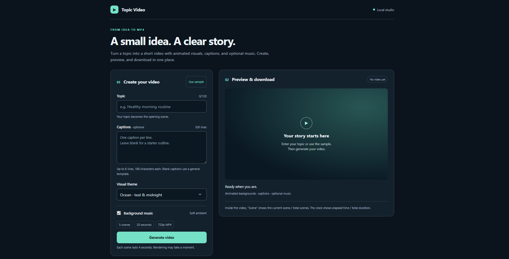
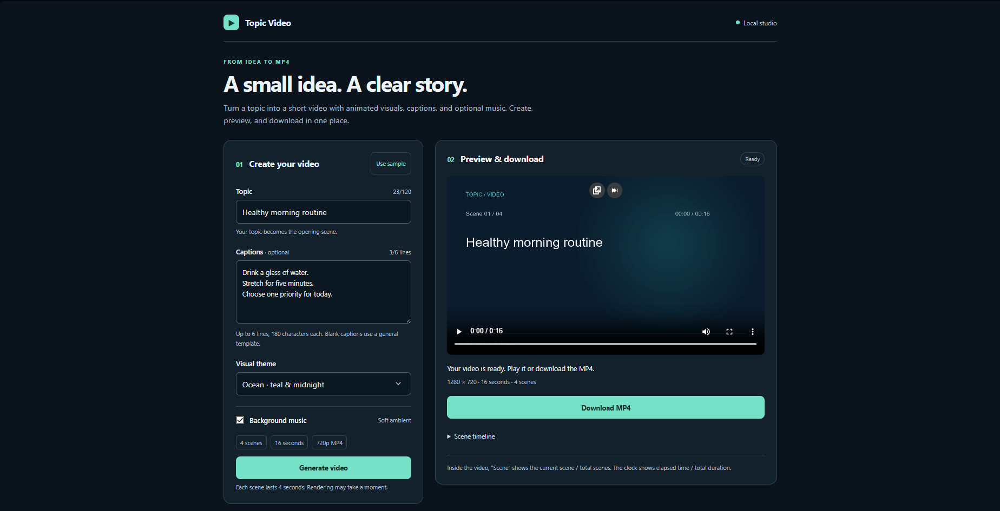
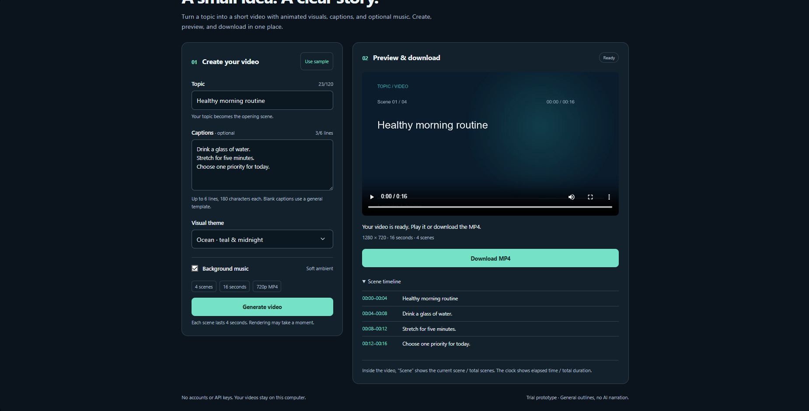

# Topic Video

A simple local video generator: enter a topic, add optional captions, and download a short **720p MP4** with animated backgrounds and optional music. No account, API key, or online content service is required to generate videos.



## What it does

- Creates an opening scene from your topic and up to six caption scenes.
- Offers Ocean, Sunset, and Ink visual themes.
- Adds burned-in captions, a scene counter, and elapsed video time.
- Generates original synthesized background music when enabled.
- Shows render progress, a video preview, a downloadable MP4, and a scene timeline.
- Remembers your form and last video, and resumes job polling after a page refresh.

Every scene lasts **4 seconds**. A title plus three captions produces **4 scenes / 16 seconds**. Leaving captions blank produces a general starter outline with **5 scenes / 20 seconds**. The maximum is **7 scenes / 28 seconds**.

## Requirements

- **Python 3.12 or newer**.
- Internet access to install dependencies; rendering works offline afterward.
- A recent browser.

The project uses **Pillow** to draw frames and **FFmpeg**, supplied by `imageio-ffmpeg`, to encode videos. A separate FFmpeg installation is normally unnecessary on supported platforms. Windows with Python 3.12 is the verified environment; macOS/Linux commands are provided below but have not been tested for this project.

## Run locally

### Windows / PowerShell

```powershell
git clone https://github.com/dianaangan/topic-video.git
cd topic-video
py -3.12 -m venv .venv
.\.venv\Scripts\python.exe -m pip install -r requirements.txt
.\.venv\Scripts\python.exe run.py
```

If you have a newer Python version, replace `py -3.12` with its installed version or use `python`.

### macOS / Linux

```bash
git clone https://github.com/dianaangan/topic-video.git
cd topic-video
python3 -m venv .venv
.venv/bin/python -m pip install -r requirements.txt
.venv/bin/python run.py
```

Open **[http://127.0.0.1:8000](http://127.0.0.1:8000)**. Keep the terminal running while using the app. Press **Ctrl+C** to stop. An active render may finish before shutdown.

You can also download the repository ZIP from GitHub, extract it, and run the same commands from the extracted folder, skipping `git clone` and `cd topic-video`.

## Try the sample

Click **Use sample**, then **Generate video**. Or enter:

**Topic:** `Healthy morning routine`

**Captions:**

```text
Drink a glass of water.
Stretch for five minutes.
Choose one priority for today.
```

Choose Ocean and leave Background music enabled. Wait for **Your video is ready**, then play it or click **Download MP4**.



Expected scene timing:

- **00:00–00:04:** Healthy morning routine.
- **00:04–00:08:** Drink a glass of water.
- **00:08–00:12:** Stretch for five minutes.
- **00:12–00:16:** Choose one priority for today.

The title counts as scene 1. `Scene 02 / 04` means the second of four scenes. `00:04 / 00:16` means elapsed time / total duration. The clock displays whole elapsed seconds, so the final frame reads `00:15 / 00:16` before the video ends at 16 seconds.

Expand **Scene timeline** to review all captions and their times:



The repository includes a [sample MP4](sample.mp4) and a [sample frame](sample-frame.png). Download the MP4 to play it if GitHub only shows a file link.

## How it works

1. The browser validates the topic and captions and submits a render job.
2. The local Python server accepts one job at a time and starts a background worker.
3. The renderer creates scenes and draws animated RGB frames with Pillow.
4. FFmpeg encodes the frames as H.264 video. Optional synthesized audio is added as AAC.
5. The server saves the MP4 in `output/`; the browser polls progress and displays the result.

The video format is **1280 × 720, 24 fps, H.264 MP4**, with optional AAC audio. Byte-range support allows browser seeking. Finished files remain in `output/` until you remove them. Restarting the server clears in-memory job statuses but preserves video files.

## Project structure

```text
topic-video/
├── generator.py          # Scene planning, frame drawing, audio, and MP4 encoding
├── server.py             # Local HTTP API, background worker, and file serving
├── run.py                # App launcher
├── requirements.txt      # Pinned Python dependencies
├── web/
│   ├── index.html        # Accessible form and preview layout
│   ├── styles.css        # Responsive styling
│   └── app.js            # Validation, polling, preview, and refresh recovery
├── tests/
│   ├── test_generator.py # Unit tests
│   └── check_app.py      # End-to-end API and video checks
├── docs/screenshots/     # Screenshots displayed in this README
├── sample.mp4            # Included 16-second example
├── TESTING.md            # Manual test inputs and expected results
└── VERIFICATION.md       # Recorded checks and verification limits
```

Frontend, server, and renderer are separate so changes to the interface do not require changing encoding logic. Inputs are validated on both client and server. User text never becomes a shell command. Temporary render files are cleaned up, and completed MP4s are published only after encoding succeeds.

## Testing

Run the unit tests from the project folder:

```powershell
.\.venv\Scripts\python.exe -m unittest discover -s tests
```

For end-to-end checks, keep `run.py` running in one terminal and run this in a second terminal, with the app idle:

```powershell
.\.venv\Scripts\python.exe tests/check_app.py
```

On macOS/Linux, replace `.\.venv\Scripts\python.exe` with `.venv/bin/python`.

The end-to-end script generates two videos, replaces `sample.mp4`, and checks actual video duration, scene-boundary frames, audio on/off, input validation, overlapping jobs, downloads, and byte-range seeking. It exits with an error if a check fails.

For a quick manual check: use the sample, play it, seek to **9 seconds** (the stretch caption), then download and open the MP4 in a video player. See [TESTING.md](TESTING.md) for additional cases and [VERIFICATION.md](VERIFICATION.md) for the checks completed on Windows.

## API

Create a job with `POST /api/jobs`:

```json
{
  "topic": "Healthy morning routine",
  "captions": ["Drink a glass of water.", "Stretch for five minutes."],
  "theme": "ocean",
  "music": true
}
```

The response is HTTP `202` with an `id`. Poll `GET /api/jobs/{id}` for `status` and `progress`. Completed jobs include `url`, `duration`, `resolution`, `scenes`, and `timeline`.

Invalid input returns `400`; a render already in progress returns `409`. The server binds to `127.0.0.1:8000`, and browser render requests must use that origin.

## Troubleshooting

- **Python is not found:** install Python 3.12 or newer, reopen your terminal, and confirm `py --version` or `python --version` works.
- **Missing dependencies:** run the install command using the same virtual-environment Python used to start the app.
- **Cannot reach the server:** keep its terminal running and open exactly `http://127.0.0.1:8000`.
- **Port 8000 is in use:** stop another copy of the app or the other application using that port, then start again.
- **A job is already rendering:** wait for it to finish before starting another.
- **Render failed:** read the server terminal for the error, correct the cause, and try again.
- **No music:** enable Background music before generating and unmute the player.
- **Font characters are missing:** English/Latin text is the verified target. Set `VIDEO_FONT` to an appropriate TrueType font path before launching to support other characters.

## Scope

This is a local trial prototype. Blank captions use a deterministic general template; the app does not research a topic or generate factual AI scripts. It does not include stock footage, narration, authentication, durable job storage, cancellation, or automatic file retention cleanup.

Potential next steps are editable AI-generated scripts, licensed footage, and narration, each behind a separate provider interface. Public hosting would also require a production web server, authentication, a durable queue, storage, and resource limits.

The prototype was implemented with assistance from Codex. Screenshots show the actual local app.
